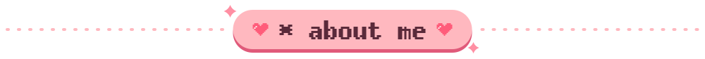
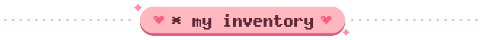
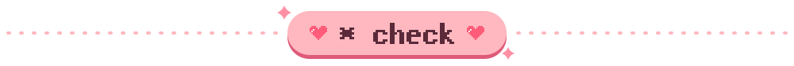
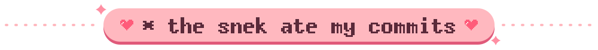

  

<i>* (psst... the buttons actually work.)</i>

  

 

 

  

  

<picture>
  <source media="(prefers-color-scheme: dark)" srcset="https://raw.githubusercontent.com/Frsxk/Frsxk/output/snake-dark.svg"/>
  <source media="(prefers-color-scheme: light)" srcset="https://raw.githubusercontent.com/Frsxk/Frsxk/output/snake.svg"/>
  
</picture>

<!---
Frsxk/Frsxk is a ✨ special ✨ repository because its `README.md` (this file) appears on your GitHub profile.
The pixel-art SVGs in ./assets are generated - edit assets/src/build.py and run `python3 assets/src/build.py`.
--->
